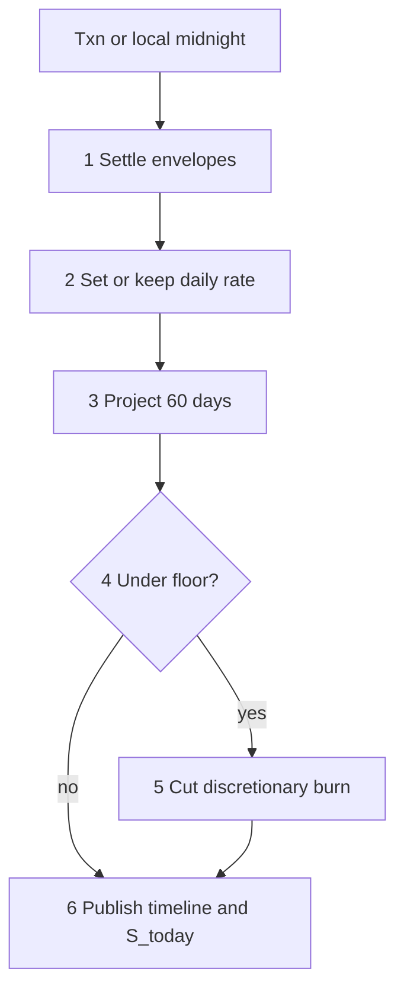

# Orbit Money — implementation plan

Step-by-step build of the application described in [docs/README.md](README.md), against the Neon Postgres database configured in local `.env` (`DATABASE_URL` pooled for request traffic; `DATABASE_URL_UNPOOLED` for migrations and long transactions). Seeded Harbor walkthrough data is served through real `/api/v1` routes so the UI always talks to the API, never to fixtures in components.

**Repository:** [AllanTorresBass/orbit-money](https://github.com/AllanTorresBass/orbit-money.git)  
**Local foundation:** architecture docs, UI guides, `.cursor/rules/`, engineering rules.  
**Locked stack:** TypeScript, Next.js App Router, React, Tailwind, shadcn/ui, TanStack Query, React Hook Form, Zod, `pg` pool, no ORM, RLS, integer cents.

**Defaults for open product choices**

| Topic | Choice for this plan |
| --- | --- |
| Database | Neon via `.env` (`DATABASE_URL` / unpooled twin) |
| API data | Real routes; Harbor seed rows in Postgres (“mock data from the API”) |
| Auth (phase 1) | Dev session header + seeded users (Blair, Alex, Casey); Auth.js email later |
| Bank feed | Manual balances only until a vendor is chosen |
| Host | Vercel; midnight evaluation via Vercel Cron per timezone batch |
| Billing | Owner capability stub only |

---

## Workflow analysis — inefficiencies and edge traps

A naive budget app creates work the engines were designed to remove. Treat these as anti-goals and as test cases.



| Hidden inefficiency | Why it hurts | Guard in this build |
| --- | --- | --- |
| Categorizing every coffee | Cognitive load the product removes | Discretionary purchase is amount-only; one Spending pool (D2) |
| Manual envelope transfers | Fake bank moves | No transfer API; envelopes are virtual only |
| Cap clipping a known bill | Silent underfunding | Due amount = schedule; cap only when no schedule (D3) |
| UUID priority ties | Unexplainable payday split | Unique `(tenant, tier, priority)` (D5) |
| Single sweep destination when full | Leftover stuck in Spending | Cascade sinks by room (D6) |
| Keeping morning burn after overspend | Double-counts the coffee in the forecast | Rebake future burn when `S_today < 0` (D7) |
| Burning `C(0)` again | Invented shortfall | Forecast starts from post-txn cash (D9) |
| UTC midnight for all tenants | Evening spend lands on wrong day | IANA `tenants.timezone` batch (D10) |
| Hard-coded 1st/15th | Wrong semi-monthly payday | Two monthly rrules (D11) |
| Raiding rent for overspend or breach | Destroys reserves | Deficit and cuts hit discretionary only (D12, D14) |
| Double post / double sweep | Wrong balances | Idempotency keys + `settled_at` + `cycle_sweeps` (D13) |
| Isolation only in `WHERE` | Cross-tenant leak | RLS + `set_config` every request (module 6) |
| Client-editable safe-to-spend | Lies on Today | Only the pipeline writes allowance/forecast |
| Setup before first number | Form fatigue | Create is three questions; seed Spending + Emergency |

**Edge matrix the engines must cover** (from [00-decisions](00-decisions.md) and modules 2–8): floor remainder on today; null installment / null cap; inflow smaller than tier 1; fixed overdraw absorption; payday today with `N_p = 1`; no future inflow → no rate; missing holiday calendar → fail closed; at most two breach cuts; advisor cannot spend; member cannot accept own proposal; explicit tenant when multi-membership.

---

## Phase 0 — Repo and environment

1. Keep `.env` local (already gitignored). Ship [`.env.example`](../.env.example) with the same keys and empty values.
2. Validate env at startup: require `DATABASE_URL` and `DATABASE_URL_UNPOOLED`.
3. Push docs to GitHub when `AllanTorresBass` auth works (`git push -u origin main`).
4. Scaffold Next.js (App Router, TypeScript, Tailwind, ESLint) in this folder beside `docs/`.
5. Add shadcn/ui, TanStack Query, Zod, React Hook Form, `pg`, `rrule`, a timezone library (`Temporal` polyfill or `luxon`), Vitest.

**Done when:** `pnpm dev` starts; a health route opens a pooled connection and returns `{ ok: true }`.

---

## Phase 1 — Money and calendar primitives

Pure modules under `lib/money/` and `lib/calendar/` with unit tests against walkthrough numbers.

- `floorCents` / `ceilCents`; never use binary float for allocation.
- `bookedDate(instant, ianaZone)`.
- `daysUntilNextInflow` → `N_p` or `null` (D8).
- Business-day shift: inflows previous BD, outflows next; US holiday set; missing calendar fails closed.
- Semi-monthly as two monthly rules; clamp short months then shift (D11).

**Done when:** `$1570 / 14` → daily `112.14`, remainder `0.04`; Harbor date math matches [09-end-to-end-walkthrough](09-end-to-end-walkthrough.md).

---

## Phase 2 — Schema, RLS, and Harbor seed

SQL migrations run against `DATABASE_URL_UNPOOLED`.

1. Tables from [05-relational-data-architecture](05-relational-data-architecture.md): tenants, users, memberships, accounts, envelopes (tier/rollover check + one discretionary), schedules, transactions, allocations, allowance_snapshots, forecast_days, proposals, cycle_sweeps, overrides.
2. ENABLE + FORCE RLS; policies on `app.current_tenant_id` / membership ([06-multi-tenancy](06-multi-tenancy.md)).
3. Connection helpers: pooled `DATABASE_URL` for API; `withTransaction` sets `set_config(..., true)` then runs work.
4. Seed script (idempotent): Harbor household, Blair (owner), Alex (admin), Casey (advisor); checking account; bills/goals from the walkthrough; optional settled paycheck state so Today shows `$112.18`.

**Done when:** Seed runs twice safely; a query with the wrong tenant session returns zero rows.

---

## Phase 3 — Pure engines

No DB inside these modules; callers pass cents and envelopes.

| Module | Responsibility | Primary tests |
| --- | --- | --- |
| `lib/engines/waterfall.ts` | Allocate inflow; absorb debit; cycle sweep (D2–D6, D12) | $3000 paycheck table; rent overdraw |
| `lib/engines/safe-to-spend.ts` | `S_daily`, remainder, `S_today`, future burn (D1, D7, D8) | 112.14 / 112.18; −37.82 → burn 109.23 |
| `lib/engines/forecast.ts` | 60-day recursion from `C(0)` (D9) | Days 0, 9, 13, 14 numbers |
| `lib/engines/solvency.ts` | Warning/breach; ≤2 discretionary cuts (D14) | Day-22 floor example |

**Done when:** Walkthrough sections A–D pass as unit tests without Postgres.

---

## Phase 4 — Evaluation pipeline

`lib/pipeline/run-evaluation.ts` implements the six steps in [08-daily-evaluation-pipeline](08-daily-evaluation-pipeline.md) in order. Sync path on transaction insert; midnight path iterates tenants by timezone.

Settlement: ledger insert + balances + envelope updates + `settled_at` in one transaction. Retries hit `(tenant_id, idempotency_key)`.

**Done when:** Seeded inflow + $40 purchase reproduces checking `4960`, Spending `1530`, `S_today` `72.18` in the database.

---

## Phase 5 — Services and `/api/v1` (mock data from the API)

Layering: Screen → Component → Hook → Service (`BaseService`) → Route → SQL ([10-engineering-rules](10-engineering-rules.md)).

Dev auth: `x-user-id` + `x-tenant-id` headers (or cookie) mapped to seeded memberships. Production later swaps to Auth.js without changing service method shapes.

| Area | Routes (illustrative) |
| --- | --- |
| Session | `GET /api/v1/me`, memberships |
| Today | `GET /api/v1/allowance` |
| Ahead | `GET /api/v1/forecast`, day detail |
| Plan | `GET/POST/PATCH` envelopes and schedules; proposals accept/decline |
| Spend | `POST /api/v1/transactions` (idempotency key) |
| People | invite, role change (RBAC from [07-rbac](07-rbac.md)) |
| You | liquidity floor, accounts |
| Health / cron | `GET /api/v1/health`, `POST /api/v1/cron/midnight` |

UI never imports seed JSON. Hooks call services; services call these routes; routes read Neon.

**Done when:** `curl` with Blair headers returns Harbor allowance and forecast JSON matching the walkthrough.

---

## Phase 6 — UI (Today, Ahead, Plan, You)

Follow [ui/README.md](ui/README.md), [03-screens](ui/03-screens.md), [04-flows](ui/04-flows.md).

1. Shell: one column, bottom tabs, paper/ink tokens.
2. Today hero + Add a purchase sheet.
3. Ahead 60-day line + day sheet.
4. Plan bills/goals/Spending + suggest/accept.
5. Create (3 steps) writing real tenant rows.
6. You: people, keep-at-least, bank manual balance.
7. Role UX: hide actions advisors cannot perform; word banlist for engine terms.

**Done when:** First-evening, ordinary purchase, past-pace, shortfall banner, and advisor invite flows work against the API.

---

## Phase 7 — Hardening and observability

- Granular pipeline events: trigger, tenant, step, cents in/out, breach day, idempotency hit (logger only; no payee PII).
- Cron: one job that groups tenants by timezone and runs local midnight.
- Integration tests on Neon (or a Neon branch) for RBAC denials and RLS.
- Rotate to Auth.js email; remove header auth.
- Push remaining commits; Vercel project with env vars from Neon.

**Done when:** P0 review checklist in `.cursor/rules/code-review.mdc` is clean; walkthrough E (Casey denied) passes.

---

## Build order (dependency)

```text
0 Env + Next scaffold
1 Cents + calendar
2 Schema + RLS + Harbor seed on Neon
3 Pure waterfall / rate / forecast / solvency
4 Pipeline + idempotent settlement
5 API + services + hooks (UI consumes API only)
6 Screens and flows
7 Cron, auth upgrade, deploy
```

Do not ship a screen that computes `S_today` in the client. Do not reorder pipeline steps. Do not introduce an ORM.

---

## Acceptance checklist (release bar)

- [ ] Walkthrough paycheck, rate, forecast, $40 spend, overspend rebake, midnight, sweep, breach cut
- [ ] Create → first number without adding a bill
- [ ] Offline purchase queue + idempotent retry (when offline support ships)
- [ ] Advisor: hero visible, no Add purchase
- [ ] Member proposal cannot self-accept
- [ ] Wrong tenant session returns empty/deny
- [ ] No `any`, no `console.*`, no secrets in git
- [ ] `.env` absent from remote; `.env.example` present
