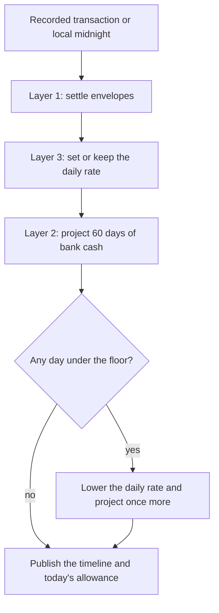

# Tri-Layer Expense Management Architecture

Implementation guide for the *System Architecture & Engineering Specification*: a deterministic engine that integrates zero-based envelopes, a cash-flow projection, and a dynamic safe-to-spend limit.

The source document is `Expense Management System Architecture (1).pdf` (5 pages). These guides restate that specification as ordered procedures. Choices the PDF leaves open are locked in [Decisions](00-decisions.md). Worked numbers illustrate the formulas. They are not sample data from the specification.

## Why the system is shaped this way

Personal budgets usually fail for two reasons:

- **Retrospective latency.** Costs are logged after the money has already left.
- **Cognitive burnout.** The user must reconcile every purchase into many categories.

This system replaces that with three computational layers. Physical bank accounts stay untouched. Envelopes are virtual compartments. The user is asked to act on one number: what is safe to spend today.

## The three layers

| Layer | Responsibility | Mechanism | What the user sees |
| --- | --- | --- | --- |
| 1. Allocation | Zero-based virtual envelopes | Priority waterfall with a strict zero-sum constraint | Paychecks split into deterministic buckets. No manual transfers. |
| 2. Forecast | Cash-flow timeline | 60-day discrete-time recursion and a solvency check | A forward graph that warns of shortfalls weeks ahead. |
| 3. Interface | Dynamic safe-to-spend | Discretionary pool divided by days left in the cycle, with overspend spread across those days | One daily discretionary amount. |

## Module guides

Read [Decisions](00-decisions.md) once, then the modules in order. Later modules call earlier ones. The [walkthrough](09-end-to-end-walkthrough.md) is the numerical check that the procedures agree.

1. [Foundational model](01-foundational-model.md) — terms, the zero-sum rule, and how the layers hand work to each other.
2. [Waterfall allocation engine](02-waterfall-allocation-engine.md) — Layer 1. Assign every inflow dollar.
3. [Cash-flow forecast engine](03-cash-flow-forecast-engine.md) — Layer 2. Project physical balances for 60 days.
4. [Safe-to-spend](04-safe-to-spend.md) — Layer 3. Compute and dampen the daily allowance.
5. [Relational data architecture](05-relational-data-architecture.md) — accounts, envelopes, schedules, transactions.
6. [Multi-tenancy and isolation](06-multi-tenancy.md) — tenants, memberships, envelope visibility, row-level security.
7. [Role-based access control](07-rbac.md) — owner, admin, member, advisor, read-only.
8. [Daily evaluation pipeline](08-daily-evaluation-pipeline.md) — the six-step state machine that runs the layers.
9. [End-to-end walkthrough](09-end-to-end-walkthrough.md) — one paycheck, one debit, and the midnight batch, in order.

The interface is specified separately, for a person who will never see these modules: [Orbit interface](ui/README.md).

How the code is structured and reviewed: [Engineering rules](10-engineering-rules.md). The short form of those rules is in `.cursor/rules/`.

## Symbols used throughout

| Symbol | Meaning |
| --- | --- |
| `E` | The full set of envelopes. |
| `E_fixed`, `E_sink`, `E_disc` | Fixed contractual, sinking-fund, and discretionary envelopes. They are disjoint and cover `E`. |
| `I(t)` | Income inflow on day `t`. |
| `A_j(t)` | Virtual dollars assigned to envelope `j` on day `t`. Always `≥ 0`. |
| `B_j(t)` | Virtual balance of envelope `j` at day `t`. |
| `C(τ)` | Aggregate physical bank liquidity on day `τ`. |
| `C_min` | Liquidity floor that must not be breached. The specification uses `$200.00` as the example. |
| `O_sched(τ)` | Scheduled fixed debits on day `τ`. |
| `O_unfunded` | Contractual liabilities that are due and have no envelope backing. |
| `S_daily(t)` | Base daily discretionary rate for the current pay cycle. |
| `S_today(t)` | What may still be spent today after today's discretionary spending. |
| `N_p` | Calendar days remaining until the next scheduled income deposit. |
| `H` | Forecast horizon. Fixed at 60 days. |

## Invariants that every module must preserve

1. **Zero-sum inflows.** On any day with income, `I(t) = Σ A_j(t)` over all envelopes. Nothing is left unassigned, and no allocation is negative.
2. **Physical and virtual stay separate.** Allocation changes envelope balances. It does not move money between bank accounts.
3. **Fixed reserves are protected.** An envelope overdraw is absorbed from the discretionary balance. It does not reduce fixed-envelope balances.
4. **Tenant isolation is a database rule.** Application queries run under `app.current_tenant_id` and `app.current_user_id`. Isolation is not left to ad-hoc `WHERE` clauses alone.
5. **The pipeline is the only writer of derived state.** Safe-to-spend and the 60-day projection are results of the evaluation pipeline, not values the client edits.
