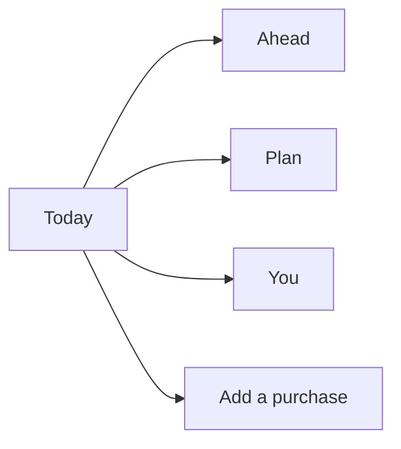

# Orbit interface

How the product should look, read, and move. The engine underneath is the [three-layer architecture](../README.md). This guide is the surface a person actually touches.

The person using Orbit is keeping a household, not operating software. They should be able to open the app, see what they can spend, and leave. Everything else is one tap away, and most days they will not need it.

## Design stance

Current finance apps compete by adding charts, scores, and categories. Orbit goes the other way. The current pattern worth keeping is a quiet screen, a large number, and a short sentence under it. The pattern worth leaving behind is the dashboard: many cards, many colors, and a chart the person has to interpret.

Orbit is a single calm column. On a phone it fills the screen. On a larger display the same column sits in the middle, with empty space on both sides. The desktop view does not grow new panels.

```text
┌─────────────────────────────┐
│  Harbor                     │
│                             │
│  You can spend              │
│  $112.18                    │
│  Until payday on Nov 18.    │
│                             │
│  [ Add a purchase ]         │
│                             │
│                             │
│  Today    Ahead    Plan     │
└─────────────────────────────┘
```

## Principles

1. **One idea per screen.** Today answers "what can I spend?" Ahead answers "will the bank be all right?" Plan answers "where did payday go?"
2. **One primary action.** If a screen asks for a tap, there is one filled button. Everything else is a text row.
3. **Plain words.** The interface never says envelope, waterfall, tier, solvency, discretionary, tenant, or safe-to-spend. The [word list](#words-on-screen) is the only vocabulary.
4. **The number is the interface.** Color, badges, and icons do not carry a meaning the sentence does not also say.
5. **Absent, not disabled.** A person who cannot do something does not see a grey button. An advisor does not see "Add a purchase."
6. **No category for daily life.** Groceries, coffee, and similar purchases are just an amount. Bills and goals are named because they are planned.
7. **Reassure by calm, not by celebration.** No confetti, streaks, scores, or applause when someone stays under the pace.

## Words on screen

| Person sees | Engine term | Example |
| --- | --- | --- |
| You can spend | `S_today`, including leftover cents | $112.18 |
| Daily pace | Morning `S_daily` | $112.14, shown only when today went past it |
| Payday | Next normalized inflow | Nov 18 |
| Bills | Fixed envelopes | Rent, Electric |
| Goals | Sinking envelopes | Car insurance, Vacation, Emergency |
| Spending | The one discretionary pool | The money for ordinary days |
| Money in the bank | Sum of account balances, `C(0)` | $5,000 |
| Keep at least | `liquidity_floor` | $200 |
| Getting low | Warning band | A day is close to the floor |
| Not enough ahead | Breach | A future day is under the floor |
| Payday split | The waterfall result | Rent $1,200, then goals, then Spending |
| Suggest a change | A member proposal | "Raise the electric ceiling to $180" |
| Household, Personal, or Organization | `tenant_type` | The name they chose, plus this quiet label |

Rules for the words:

- Money is written `$1,200` with a thousands separator and two decimals only when the cents are not `.00`. The hero number on Today always shows cents, because `$112.18` and `$112.14` are different.
- Dates are "Nov 18" or "Friday, Nov 13". Never an ISO date.
- The household name is the title. "Harbor" is enough. "Harbor household" is the subtitle, in the secondary color, and only when the type is household or organization.
- Buttons are verbs the person would say: "Add a purchase", "Save", "Invite Alex".

## Navigation

Three destinations. The same three for every role. The bar is at the bottom on a phone and stays at the bottom of the column on a larger screen.

| Tab | Question it answers | Opens |
| --- | --- | --- |
| Today | What can I spend right now? | The hero number |
| Ahead | Will there be enough in the bank? | The next 60 days |
| Plan | Where does payday go? | Bills, goals, and Spending |

A fourth tab is not added for settings. The name at the top of Today opens **You**. That sheet holds the few account tasks the role allows: people, bank, "keep at least", billing, and sign out.

Someone in more than one household sees the household name as a button. Tapping it lists the other names. Someone in one household sees the name as plain text.



Back is the system back gesture or a single "Close" on a sheet. There is no in-app stack of breadcrumbs.

## Who sees which actions

The tabs stay. The actions inside them follow [access control](../07-rbac.md).

| Action | Owner | Admin | Member | Advisor | Read-only |
| --- | --- | --- | --- | --- | --- |
| Read Today, Ahead, and Plan | Yes | Yes | Yes | Yes | Yes |
| Add a purchase | Yes | Yes | Yes | | |
| Suggest a change to a bill or goal | | | Yes | | |
| Edit a bill, goal, or payday | Yes | Yes | | | |
| Accept a suggestion | Yes | Yes | | | |
| Connect a bank, edit "keep at least" | Yes | Yes | | | |
| Invite or remove someone | Yes | Yes | | | |
| Billing and ownership | Yes | | | | |

A hidden bill or goal is omitted from Plan for that person. Ahead still shows money in the bank, labeled "All money in connected accounts." The screen does not say that something is hidden.

## Where to read next

- [Visual design](02-visual-design.md) — type, color, space, motion.
- [Screens](03-screens.md) — every screen, top to bottom.
- [Flows](04-flows.md) — first run, a purchase, payday, a shortfall, inviting someone.
